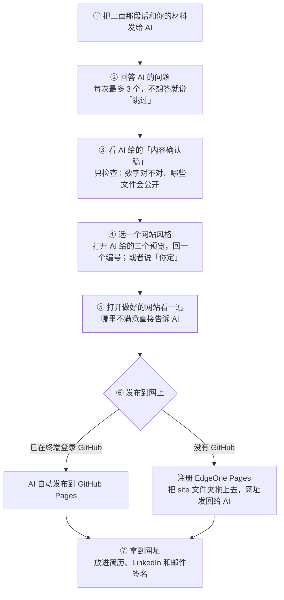

# 个人简历网站 Skill（resume-portfolio-site）

把你已有的求职材料交给 AI，回答它的几个问题，就能得到一个**图文并茂、可交互、支持多语言**的个人简历网站，和一个可以直接发给 HR 的链接。

不需要会写代码，也不需要知道网站该写什么：AI 会先读你的材料，再像求职顾问一样问你问题，最后把网站做好。

> 作者：zmx1122 · 配套教程见小红书同名账号 @笨比本比

**在线演示**：[https://zmx1122.github.io/resume-portfolio-demo/](https://zmx1122.github.io/resume-portfolio-demo/)（虚构人物"陈梅"，由这个 skill 在测试中生成）

- **第一部分：[零基础使用指南](#第一部分零基础使用指南)**：不懂技术？只看这一部分就够了
- **第二部分：[技术说明](#第二部分技术说明)**：想安装成 skill、修改模板、参与开发，看这一部分
- [English summary](#english-summary)

---

## 第一部分：零基础使用指南

### 你需要准备的

| | 内容 |
|---|---|
| 1 | **一个装着求职材料的文件夹**。有什么放什么：简历（几个版本都行）、LinkedIn 导出的 PDF（在自己的主页点"更多 → 存为 PDF"）、求职信、工作或实习证明、推荐信、证书、成绩单、获奖证书、头像、项目照片或截图。没有的不用找，AI 会问你。 |
| 2 | **一个 AI 工具**。见下面"用哪个 AI"。 |
| 3 | **一个 GitHub 账号，并在终端里登录一次**（推荐，AI 就能自动帮你把网站发布到网上）。打开电脑的"终端"，输入 `gh auth login`，按提示选 GitHub.com → HTTPS → 用浏览器登录。还没装 `gh` 的话，先看[这里](references/deploy.md#41-准备-github每台电脑只需一次)，或者让 AI 教你。**没有 GitHub 也可以**，AI 会教你用 EdgeOne Pages，只需要一个邮箱注册。 |
| 4 | **大约 1 小时**。 |

### 先看看做出来是什么样

打开[在线演示](https://zmx1122.github.io/resume-portfolio-demo/)，这是用虚构人物"陈梅"的材料做出来的网站。同一份内容换成其他风格：
[报纸编辑风](https://zmx1122.github.io/resume-portfolio-demo/?style=editorial) ·
[Bento 卡片](https://zmx1122.github.io/resume-portfolio-demo/?style=bento) ·
[暗色科技](https://zmx1122.github.io/resume-portfolio-demo/?style=terminal-dark) ·
[温暖作品集](https://zmx1122.github.io/resume-portfolio-demo/?style=warm-portfolio) ·
[学术简约](https://zmx1122.github.io/resume-portfolio-demo/?style=academic)（默认是瑞士极简）

### 用哪个 AI

| AI 类型 | 例子 | 体验 |
|---|---|---|
| **能直接操作你电脑上文件的 AI**（推荐） | 豆包电脑版的"工作任务"模式、Claude 桌面版、Claude Code、Cursor 等 | AI 帮你做好全部文件，你只需要回答问题、看效果、最后把一个文件夹拖到网页上 |
| **只能聊天的 AI** | ChatGPT、豆包网页版、Kimi、DeepSeek 等 | 也能用。采访和写内容都一样，但最后需要你自己下载一个压缩包、替换一个文件，AI 会一步步教你 |

### 复制这段话，发给 AI

把材料作为附件一起发过去；如果你的 AI 能读电脑上的文件，也可以写上材料文件夹的位置。

```
请先完整阅读这个项目的说明：https://github.com/Zmx1122/resume-portfolio-site
（先读 SKILL.md，再按需要读 references 文件夹里的文件），
然后严格按照里面的流程，帮我做一个个人简历网站。
我的求职材料在附件里（或者：在我电脑上的这个文件夹：______）。
我不会写代码，请用简单的话告诉我每一步要做什么。
```

用的是豆包电脑版，也可以先把这个项目安装成"技能"（方法见[第二部分](#安装成-skill)），之后只要说"帮我做一个个人简历网站"就行。

### 整个流程



### 每一步你要做什么

1. **发消息**：复制上面那段话，连同材料一起发给 AI。
2. **回答问题**：AI 会先告诉你它从材料里读到了什么，然后开始提问，每次最多 3 个问题。**真正必须回答的只有四件事**：找什么工作、网站用哪几种语言（最多三种，比如德语 + 英语 + 中文）、名字怎么写、哪些联系方式可以公开。其他问题不知道就说"跳过"，想让 AI 出主意就说"你帮我建议"，看不懂就问"这是什么意思"。
3. **确认内容**：AI 会给你一份"内容确认稿"。你只需要重点看两样：**网站上的数字对不对**，**哪些文件会公开**。没问题就回"可以"。不确定的数字，AI 默认不放。
4. **选风格**：AI 会用你自己的内容做三个风格预览，你打开看一下，回一个编号。不想选就说"你定"，以后随时可以换。
5. **看网站、提修改**：双击 AI 告诉你的 `index.html` 打开网站，哪里不满意直接说，比如"头像换成圆的""第二段经历写短一点"。
6. **发布**：AI 会先问你网站主要给谁看（见下面"三种发布方案"）。
   - 你已经在终端里登录过 GitHub：AI 直接帮你发布，给你一个 `https://你的用户名.github.io/` 的网址。
   - 没有 GitHub：AI 会教你注册 EdgeOne Pages，把 AI 指给你的 **`site` 文件夹**拖进网页（只拖 `site` 这一个文件夹，不要拖外面那层），然后把得到的网址发回给 AI 检查。

   注册和登录都由你自己完成。不要把密码或令牌（token）发给 AI。
7. **用起来**：把链接放进简历页眉、LinkedIn 的"精选"和联系信息、求职信签名、邮件签名。

### 三种发布方案

| 方案 | 适合 | 用什么 | 花费 |
|---|---|---|---|
| **① 海外为主**（默认） | 在德国、欧洲或其他国家求职 | GitHub Pages；没有 GitHub 就用 EdgeOne Pages | 免费 |
| **② 全球都能打开** | 海外求职，也想让国内的人稳定打开 | 自己的域名 + EdgeOne Pages（全球可用区，不含中国大陆），不需要备案 | 域名每年约几欧元到十几欧元 |
| **③ 国内为主** | 主要投国内岗位 | 自己的域名 + 国内服务器 + ICP 备案（需要身份证和国内手机号，通常要几周） | 域名费用 |

免费平台给的默认网址在中国大陆都不稳定，所以想让国内的人稳定打开，就需要选 ② 或 ③。详细步骤见 [deploy.md](references/deploy.md)。

### 常见问题

**一定要注册账号吗？**
想要一个能发给别人的网址，就需要一个免费账号：有 GitHub 就用 GitHub，没有就注册 EdgeOne Pages。如果暂时只想自己看，或者打印成 PDF，可以不注册：网站在你自己电脑上双击就能打开，"速览"页可以直接打印或存成 PDF。

**要花钱吗？**
方案 ① 不用。想让**国内**的人也能稳定打开（方案 ② 或 ③），需要买一个自己的域名，每年几欧元到十几欧元。

**国内的家人能打开吗？**
选方案 ① 的话不稳定。不想买域名，可以把网站的"速览"页存成 PDF 发给家人。

**`gh auth login` 是什么？安全吗？**
这是 GitHub 官方命令行工具的登录命令。你在浏览器里登录 GitHub，登录信息保存在你自己的电脑上，之后 AI 就能用它帮你发布网站。AI 不会看到你的密码。

**我的个人信息安全吗？**
你上传给 AI 的材料，会被你使用的那个 AI 服务处理。上传什么、网站上公开什么，**由你自己决定、自己负责**。AI 默认会建议不公开出生日期、住址、证件号、电话、成绩、签证信息、签名等，也会在发布前和你一起检查。发布前请你自己再看一遍网站。

**做完以后还能改吗？**
可以。回到同一个对话（或者新开一个对话，把网站文件夹交给 AI），说要改什么，改好后重新上传 `site` 文件夹，链接不变。

**AI 中途卡住或者乱了怎么办？**
跟它说"请重新读一遍 SKILL.md，告诉我现在进行到哪一步了"。能操作文件的 AI 会把进度记在 `我的简历网站/_work/` 里，下次可以接着做。

### 隐私与免责

这个项目只是免费开源的教程和工具。你上传给 AI 的个人信息，由你自己判断、自己负责。引用推荐信里的评价之前，建议先征得推荐人同意。公司内部的截图和数据，请确认可以公开后再使用。

---

## 第二部分：技术说明

### 这是什么

一个 **AI Skill**：一个带 `SKILL.md` 的文件夹，里面是写给 AI 看的工作流程、参考规则，以及一个网页模板。支持 `SKILL.md` 格式的 AI 工具（豆包电脑版、Claude Code 等）可以直接安装；其他 AI 可以通过 GitHub 链接阅读后照做。

主要能力：

- **资料池**：识别 8 类求职材料（多版本简历、求职信、Arbeitszeugnis、推荐信、证书、成绩单、在读证明、获奖证书）和作品素材，逐份提取信息并交叉比对，找出冲突、隐藏亮点和缺证据的说法，再转成采访问题。会解读德国工作证明里的委婉评价语。
- **有来源的内容**：每条内容都记录来源（材料编号 M / 采访编号 I）。内容模型基于 [JSON Resume](https://jsonresume.org)，扩展了故事、证据、文件、引用和多语言。
- **静态网页模板**：一个 `index.html` 加一个 `content.js`，不需要构建步骤，也不依赖外部 CDN。双击就能打开，任何静态托管平台都能直接发布。
  - 用 `#` 切换页面，网址里带语言
  - 最多三种语言，支持从右往左书写的语言
  - 紧凑型（单页）和编辑型（多页）两种布局，6 种风格皮肤，深色模式
  - 图片放大查看；文件按公开级别显示
  - 一页纸速览，可直接打印
- **检查脚本**：检查漏翻、对不上的引用、没有来源的数字、缺失的文件、网站文件夹里多余或不该公开的文件、风格设置是否一致、已经过去的日期等。
- **一键发布到 GitHub Pages**（`scripts/publish_github_pages.js`）：
  - 发布前先运行内容检查
  - 只覆盖自己创建的仓库
  - 用 GitHub 隐私邮箱提交
  - 每次只上传一个全新的版本，不留下旧内容的历史
  - 等新版本真正上线后才打印网址
- **发布指南**：按"海外为主 / 全球 / 国内为主"三种方案，覆盖 GitHub Pages、EdgeOne Pages（手动上传、命令行、MCP）、自定义域名和 ICP 备案说明。

### 安装成 skill

**豆包电脑版**：在本页点 **Code → Download ZIP** 并解压。在豆包电脑版里进入"工作任务"模式，打开侧栏的"技能"，选择"上传技能"，上传解压出来的文件夹（`SKILL.md` 所在的那一层）。界面可能会更新；上传后没有被识别时，试试把 `SKILL.md` 改名为 `skill.md`。

**Claude Code**：把整个文件夹放到 `~/.claude/skills/resume-portfolio-site/`（或项目里的 `.claude/skills/`）。

**其他支持 SKILL.md 的工具**：放进对应的技能目录。

### 文件结构

```
resume-portfolio-site/
├── SKILL.md                         # 总流程：环境判断、阶段 0–8、聊天模式
├── references/
│   ├── material-pool.md             # 资料池：分类、资料卡、敏感度分级、交叉比对
│   ├── doc-types/                   # 8 类材料的提取规则
│   ├── interview-guide.md           # 问题库、追问技巧、特殊情况
│   ├── content-model.md             # content.js 的数据结构和自检清单
│   ├── information-architecture.md  # 页面类型、布局、网址规则
│   ├── design-principles.md         # 设计原则
│   ├── styles/                      # 风格总览和 6 种风格说明
│   ├── components.md                # 模板组件、生成步骤、常见修改
│   └── deploy.md                    # 发布指南
├── assets/template/                 # 网页模板（自带虚构人物"小林"的演示内容）
└── scripts/
    ├── check_content.js             # 内容和网站文件夹检查（需要 Node.js）
    └── publish_github_pages.js      # 发布到 GitHub Pages（需要 Node.js、git、已登录的 gh）
```

### 预览模板

用浏览器打开 `assets/template/index.html`。开发时可以用网址参数切换：

- `?style=editorial`、`?style=bento`、`?style=terminal-dark`、`?style=warm-portfolio`、`?style=academic`（默认 `swiss-minimal`）
- `?layout=compact` 或 `?layout=editorial`
- 网址末尾加 `#/en/`、`#/zh/` 切换语言

### 检查脚本

```bash
node scripts/check_content.js assets/template/content.js
```

输出分为"错误"（必须修好，退出码 1）和"提醒"。传第二个参数可以注入修改来测试检查器本身，例如：

```bash
node scripts/check_content.js assets/template/content.js 'S.work[0].position = "Werkstudentin"'
```

### 已知限制

- **中国大陆访问**：各平台的默认域名在国内都不稳定（`vercel.app` 基本打不开；EdgeOne Pages 的默认域名在中国大陆只能通过 3 小时有效的预览链接访问；CloudBase 默认域名仅供测试），稳定访问需要自定义域名，放在国内服务器上还需要 ICP 备案。EdgeOne Pages 的发布流程还没有用真实账号实测过。
- **AI 能力差异**：不同 AI 工具读取 PDF 和图片、读写本地文件、运行脚本、操作浏览器的能力不同。`SKILL.md` 区分了完整模式和聊天模式，但没有在每一种工具里都实测过。
- **翻译**：AI 翻译的版本最好请母语者检查。
- **Arbeitszeugnis 解读**是业界惯例，不是法律规定。

### 参与改进

欢迎提 Issue 和 Pull Request：新的风格、更多材料类型（比如其他国家的工作证明）、更多语言的界面文字、对更多 AI 工具的实测反馈。

修改模板后，请用浏览器检查手机宽度、深色模式和每种语言，并运行检查脚本。

### 致谢与许可证

本项目以 [MIT 许可证](LICENSE) 开源。内容结构参考了 [JSON Resume](https://jsonresume.org)，设计思路参考了 Anthropic 的 frontend-design skill，信息架构参考了 [ylkhayat.vercel.app](https://ylkhayat.vercel.app)。详见 [THIRD_PARTY_NOTICES.md](THIRD_PARTY_NOTICES.md)。

---

## English summary

**resume-portfolio-site** is an AI skill that turns a job seeker's existing application documents into a multilingual, interactive personal resume website, and then walks them through publishing it as a public link. It is designed for non-technical users, with a focus on international students in Germany, but works for anyone.

**For non-technical users:** put your documents in a folder, paste the prompt from Part 1 (it points the AI to this repo's `SKILL.md`) into an AI tool, answer its questions (at most three at a time; "skip" is always fine), confirm the numbers and the files that will be public, pick a style, and publish: with a GitHub account and a one-time `gh auth login`, the AI publishes to GitHub Pages automatically; without GitHub, the user drags the generated `site` folder onto EdgeOne Pages. AI tools that can work with local files do all the file handling. Chat-only AIs also work, but the user has to download the repo ZIP once and replace one file.

**For developers:** the repo contains:
- `SKILL.md`, which sets out the workflow and covers both full and chat-only modes
- `references/`, with the material pool, extraction rules for 8 document types, the interview guide, a JSON Resume-based content model, the information architecture, design principles, 6 style specs, the component guide and the deployment guide
- `assets/template/`, a no-build static site with hash routing, up to 3 languages incl. RTL, 6 styles, dark mode, a lightbox, document visibility levels and a printable one-pager
- `scripts/check_content.js`, a content and site-folder checker

MIT licensed; see `THIRD_PARTY_NOTICES.md` for credits.
